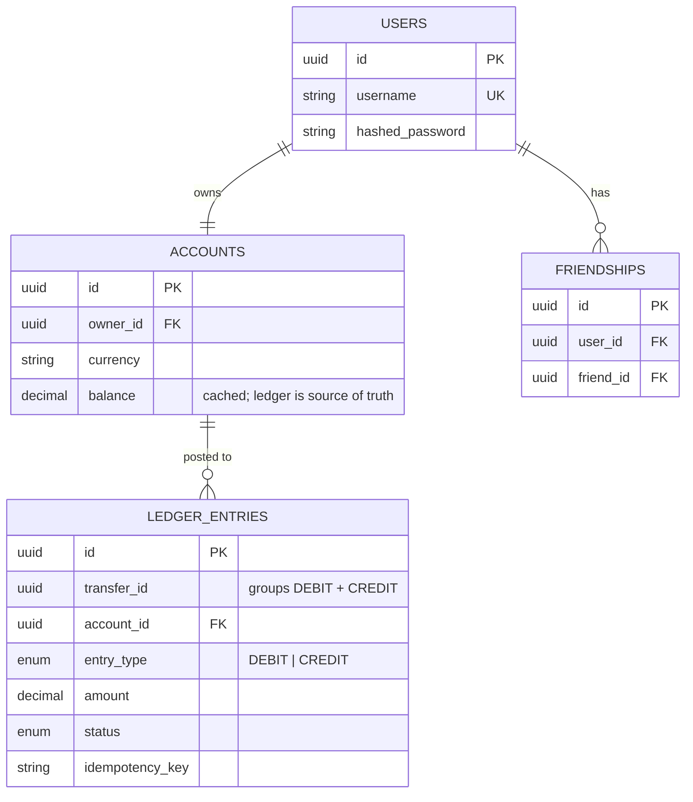

# PaymentSystem: P2P Payments App

A full-stack peer-to-peer payments app (think Venmo or Cash App) built around a
**double-entry ledger**, **row-level locking** and **idempotent transfers**. It
covers the correctness problems that real payment systems have to solve.

Users can sign up, deposit funds, add friends and send money to each other.
Every movement of money is recorded as a balanced pair of ledger entries.

<!-- TODO: add a screenshot or GIF of the dashboard here -->
<!--  -->

---

## Tech Stack

| Layer    | Tech                                                       |
| -------- | ---------------------------------------------------------- |
| Frontend | React 19, React Router 7, Vite                             |
| Backend  | Python 3.12, FastAPI, SQLAlchemy 2.0, Pydantic v2          |
| Database | MySQL 8                                                    |
| Auth     | JWT access tokens (PyJWT), bcrypt password hashing         |
| Infra    | Docker Compose, nginx (serves the SPA and proxies `/api`) |

---

## Quickstart

**Prerequisites:** Docker Desktop.

```bash
git clone https://github.com/ZacharyScheer16/PaymentSystem.git
cd PaymentSystem
cp .env.example .env        # set JWT_SECRET and DB passwords before any real use
docker compose up --build
```

| URL                          | What                          |
| ---------------------------- | ----------------------------- |
| http://localhost:3000        | The app                       |
| http://localhost:8000/docs   | Interactive API docs (Swagger) |

Useful commands:

```bash
docker compose logs -f backend   # tail backend logs
docker compose down              # stop
docker compose down -v           # stop and wipe the database
```

### Running without Docker

```bash
# Backend (needs a running MySQL with DATABASE_URL set)
cd p2p_Backend
python -m venv venv && source venv/bin/activate   # Windows: .\venv\Scripts\Activate.ps1
pip install -r Requirements.txt
uvicorn app.main:app --reload

# Frontend (Vite proxies /api to the backend)
cd p2p_Frontend
npm install
npm run dev
```

---

## Architecture


nginx serves the built React app and proxies `/api` to the backend, so the
browser only ever talks to one origin and CORS never comes into play in the
Docker setup.

The backend uses a layered design:

```
p2p_Backend/app/
├── routes/     HTTP layer: request parsing, auth dependencies, response models
├── services/   Business logic (TransferService, AccountService, ...); no HTTP here
├── models/     SQLAlchemy ORM models (User, Account, LedgerEntry, Friendship)
├── schemas/    Pydantic request/response schemas
├── core/       Config, JWT/bcrypt security, auth dependency, domain exceptions, logging
└── db/         Engine and session management
```

Services raise **domain exceptions** (`InsufficientFundsError`,
`ForbiddenError`, ...) and know nothing about HTTP. One exception handler in
`main.py` maps each of them to a status code, which keeps the business logic
testable without a web server.

### Data model



---

## Design Decisions

### 1. Double-entry ledger, not just a balance column

A transfer never just does `balance -= x`. It writes **two immutable ledger
entries** that share a `transfer_id`: a `DEBIT` on the sender and a `CREDIT` on
the receiver. Both entries and both balance updates are committed in **one
database transaction**, so they all happen or none of them do.

- **Auditability:** every balance can be explained by its ledger history.
- **Invariant:** `account.balance == sum(credits) - sum(debits)`. The
  `balance` column is a cache for fast reads, and the ledger is the source of
  truth.
- **Reversals** are made by posting new compensating entries, never by editing
  or deleting rows.

### 2. Preventing double-spend with row locks

Without locking, two concurrent $80 transfers from a $100 account can both read
`balance = 100`, both pass the funds check and overdraw the account.

`TransferService.execute_transfer` locks both account rows with
`SELECT ... FOR UPDATE` **before** checking the balance, so a second transfer on
the same account waits until the first one commits and then sees the new
balance.

### 3. Deadlock avoidance through consistent lock ordering

If transfer A→B locked A then B while transfer B→A locked B then A, each could
end up holding one lock while waiting for the other: a deadlock. Both rows are
therefore always locked **in sorted account-id order**, no matter which account
is the sender, so two transfers can never wait on each other in a cycle.

### 4. Idempotent transfers

Clients send an `idempotency_key` with every transfer and deposit. If a request
is retried (after a network timeout, a double-click, a mobile reconnect), the
server returns the **original** `transfer_id` instead of moving the money
twice. A unique constraint on `(idempotency_key, entry_type)` enforces this at
the database level too.

### 5. Decimal, never float, for money

`0.1 + 0.2 != 0.3` in floating point. Balances and amounts are stored as
`NUMERIC(18, 2)` and calculated with Python's `Decimal`.

### 6. Authorization in the service layer

The transfer service checks that the **caller owns the sender account**, and
the caller's id comes from the verified JWT, never from the request body. A
valid token for user A therefore can't be used to move money out of user B's
account.

---

## Testing

`p2p_Backend/scripts/concurrency_test.py` fires **real concurrent HTTP
requests** at a running server against MySQL. It checks that:

- concurrent transfers can't overdraw an account
- opposite-direction transfers between the same pair don't deadlock
- retried requests with the same idempotency key move money only once

```bash
docker compose up -d
cd p2p_Backend && python scripts/concurrency_test.py
```

A full pytest suite with unit, API and invariant tests, plus CI, is in progress
(see the [roadmap](ROADMAP.md)).

---

## API Overview

Full interactive docs are at `/docs` while the backend is running.

| Method | Endpoint                          | Description                       |
| ------ | --------------------------------- | --------------------------------- |
| POST   | `/api/users/`                     | Sign up                           |
| POST   | `/api/users/login`                | Log in, returns a JWT             |
| GET    | `/api/users/search?q=`            | Username typeahead search         |
| GET    | `/api/users/{username}/recipient` | Look up a recipient's account     |
| POST   | `/api/accounts/`                  | Create an account                 |
| GET    | `/api/accounts/{id}`              | Get an account and its balance    |
| POST   | `/api/accounts/{id}/deposit`      | Deposit funds (idempotent)        |
| GET    | `/api/accounts/{id}/transfers`    | Ledger history for an account     |
| POST   | `/api/transactions/`              | Send money (idempotent, atomic)   |
| GET    | `/api/friends/`                   | List friends                      |
| POST   | `/api/friends/`                   | Add a friend                      |
| DELETE | `/api/friends/{friend_id}`        | Remove a friend                   |

---

## Known Limitations and Next Steps

Simplifications I made on purpose, and what comes next:

- **One account per user** for now. The schema keeps `accounts` separate from
  `users`, so supporting multiple accounts is a small change.
- **The schema is created at startup** with `create_all`. Alembic migrations
  are next.
- **Deposits are simulated.** A planned Stripe test-mode integration would
  credit accounts only from verified, idempotent webhooks.
- **Scaling path:** read replicas for history queries, the outbox pattern for
  notifications, and sharding by account id.

Planned features include payment requests, real-time notifications, refunds,
bill splitting and scheduled payments. See **[ROADMAP.md](ROADMAP.md)**.
